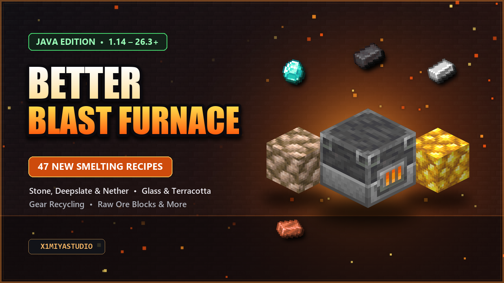

  
  

  <b>Why isn't this in vanilla Minecraft?</b> 
  The Blast Furnace is one of the most underused blocks in the game. This datapack expands its functionality with 47 logical high-temperature smelting recipes.

---

## ⚙️ Recipes Added

### 🪨 Stone & Cobblestone
| Input | Output |
|---|---|
| Cobblestone | Stone |
| Stone | Smooth Stone |
| Stone Bricks | Cracked Stone Bricks |
| Chiseled Stone Bricks | Cracked Stone Bricks |
| Mossy Cobblestone | Cobblestone |
| Mossy Stone Bricks | Stone Bricks |

### 🫙 Deepslate
| Input | Output |
|---|---|
| Cobbled Deepslate | Deepslate |
| Deepslate Bricks | Cracked Deepslate Bricks |
| Deepslate Tiles | Cracked Deepslate Tiles |
| Chiseled Deepslate | Cracked Deepslate Bricks |

### 🔴 Nether
| Input | Output |
|---|---|
| Netherrack | Nether Brick |
| Nether Bricks | Cracked Nether Bricks |
| Polished Blackstone Bricks | Cracked Polished Blackstone Bricks |

### 🏺 Clay & Terracotta
| Input | Output |
|---|---|
| Clay Ball | Brick |
| Clay | Terracotta |
| Any Colored Terracotta (×16) | Glazed Terracotta |

### 🪟 Sand & Glass
| Input | Output |
|---|---|
| Sand | Glass |
| Red Sand | Glass |
| Sandstone | Smooth Sandstone |
| Red Sandstone | Smooth Red Sandstone |

### 🗿 Other Blocks
| Input | Output |
|---|---|
| Basalt | Smooth Basalt |
| Quartz Block | Smooth Quartz |
| Tuff | Polished Tuff *(1.21+)* |

### 📦 Raw Ore Blocks
| Input | Output |
|---|---|
| Raw Iron Block | Iron Block |
| Raw Gold Block | Gold Block |
| Raw Copper Block | Copper Block |

### ⚔️ Tools & Armor → Materials
| Input | Output |
|---|---|
| Iron Tools / Armor / Chainmail | Iron Nugget |
| Gold Tools / Armor / Clock | Gold Nugget |
| Diamond Tools / Armor | Diamond |
| Netherite Tools / Armor | Netherite Ingot |

### 🪵 Bonus Fuel
| Input | Output |
|---|---|
| Any Log | Charcoal |

---

## 🕹️ Compatibility & Installation

- ✅ **Minecraft 1.14 – 26.3+** — single multi-version `.zip` powered by native **Overlays** (`overlay_1_21_2`).
- ✅ **Zero mods required** — 100% pure vanilla datapack.
- ✅ **Singleplayer & Multiplayer** — works on any server (Vanilla, Fabric, Forge, NeoForge, Paper, Purpur).

### Installation
1. Download the `.zip` archive from [Modrinth](https://modrinth.com/datapack/better-blast-furnace), [CurseForge](https://www.curseforge.com/minecraft/data-packs/better-blast-furnace-x1miyastudio), or `Better Blast Furnace v2.zip` from Releases.
2. Place it inside `<world>/datapacks/`.
3. Run `/reload` in-game (or create a new world).

---

© 2026 **[X1miyaStudio](https://github.com/X1miyaStudio)** · All Rights Reserved

