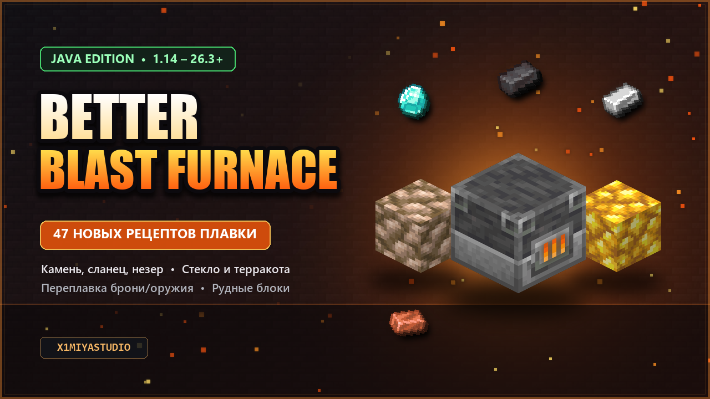

  
  

  <b>Почему этого нет в ванильном Minecraft?</b> 
  Плавильная печь — один из самых недооценённых блоков игры. Этот датапак расширяет её функционал 47 логичными высокотемпературными рецептами переплавки.

---

## ⚙️ Добавленные рецепты

### 🪨 Камень и булыжник
| Вход | Выход |
|---|---|
| Булыжник (Cobblestone) | Камень (Stone) |
| Камень (Stone) | Гладкий камень (Smooth Stone) |
| Каменные кирпичи (Stone Bricks) | Потрескавшиеся каменные кирпичи |
| Резные каменные кирпичи (Chiseled Stone Bricks) | Потрескавшиеся каменные кирпичи |
| Замшелый булыжник (Mossy Cobblestone) | Булыжник (Cobblestone) |
| Замшелые каменные кирпичи (Mossy Stone Bricks) | Каменные кирпичи (Stone Bricks) |

### 🫙 Глубинный сланец
| Вход | Выход |
|---|---|
| Дроблёный глубинный сланец | Глубинный сланец (Deepslate) |
| Кирпичи из глубинного сланца | Потрескавшиеся кирпичи из глубинного сланца |
| Плитка из глубинного сланца | Потрескавшаяся плитка из глубинного сланца |
| Резной глубинный сланец | Потрескавшиеся кирпичи из глубинного сланца |

### 🔴 Незер
| Вход | Выход |
|---|---|
| Незерак (Netherrack) | Незерский кирпич (Nether Brick) |
| Незерские кирпичи (Nether Bricks) | Потрескавшиеся незерские кирпичи |
| Полированные чернитные кирпичи | Потрескавшиеся полированные чернитные кирпичи |

### 🏺 Глина и терракота
| Вход | Выход |
|---|---|
| Комок глины (Clay Ball) | Кирпич (Brick) |
| Глина (Clay) | Терракота (Terracotta) |
| Любая цветная терракота (×16) | Глазурованная керамика (Glazed Terracotta) |

### 🪟 Песок и стекло
| Вход | Выход |
|---|---|
| Песок (Sand) | Стекло (Glass) |
| Красный песок (Red Sand) | Стекло (Glass) |
| Песчаник (Sandstone) | Гладкий песчаник (Smooth Sandstone) |
| Красный песчаник (Red Sandstone) | Гладкий красный песчаник |

### 🗿 Другие блоки
| Вход | Выход |
|---|---|
| Базальт (Basalt) | Гладкий базальт (Smooth Basalt) |
| Кварцевый блок (Quartz Block) | Гладкий кварц (Smooth Quartz) |
| Туф (Tuff) | Полированный туф *(1.21+)* |

### 📦 Блоки сырой руды
| Вход | Выход |
|---|---|
| Блок сырого железа | Железный блок |
| Блок сырого золота | Золотой блок |
| Блок сырой меди | Медный блок |

### ⚔️ Инструменты и броня → Материалы
| Вход | Выход |
|---|---|
| Железные инструменты / броня / кольчуга | Кусочек железа (Iron Nugget) |
| Золотые инструменты / броня / часы | Кусочек золота (Gold Nugget) |
| Алмазные инструменты / броня | Алмаз (Diamond) |
| Незеритовые инструменты / броня | Незеритовый слиток (Netherite Ingot) |

### 🪵 Топливо (бонус)
| Вход | Выход |
|---|---|
| Любое бревно (Any Log) | Древесный уголь (Charcoal) |

---

## 🕹️ Совместимость и установка

- ✅ **Minecraft 1.14 – 26.3+** — единый мультиверсионный `.zip` файл благодаря нативной системе **Overlays** (`overlay_1_21_2`).
- ✅ **Без модов** — абсолютно чистый ванильный датапак.
- ✅ **Одиночная игра и мультиплеер** — работает на любом сервере (Vanilla, Fabric, Forge, NeoForge, Paper, Purpur).

### Установка
1. Скачайте `.zip` файл ([Modrinth](https://modrinth.com/datapack/better-blast-furnace), [CurseForge](https://www.curseforge.com/minecraft/data-packs/better-blast-furnace-x1miyastudio) или `Better Blast Furnace v2.zip` из релизов).
2. Поместите его в папку `datapacks` вашего мира.
3. Выполните команду `/reload` в игре (или создайте новый мир).

---

© 2026 **[X1miyaStudio](https://github.com/X1miyaStudio)** · All Rights Reserved

